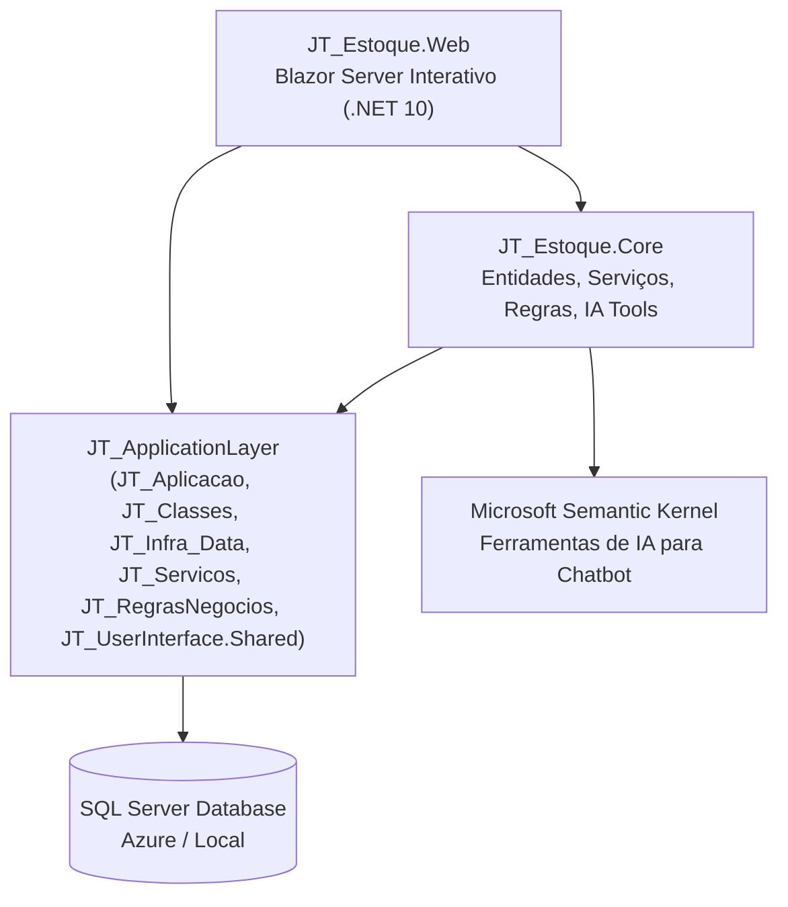

# JT_Estoque — Sistema de Gestão de Estoque, Almoxarifados e Logística

> Sistema corporativo moderno e de alta performance para controle de estoques, almoxarifados múltiplos, rastreabilidade de lotes (FEFO), ficha Kardex, auditoria por inventário físico e inteligência artificial integrada.

---

## 📌 Visão Geral

O **JT_Estoque** é o módulo vertical de gestão de suprimentos e logística da suíte de aplicações **JTech**. Construído sob uma arquitetura limpa em **.NET 10** e **Blazor Server Interativo**, o sistema opera de forma desacoplada porém nativamente integrada ao ecossistema `JT_ApplicationLayer` (com suporte a Multi-Tenancy, autorização corporativa, discovery de regras de negócio, migrações dinâmicas de schema e ferramentas de IA via Microsoft Semantic Kernel).

O sistema oferece controle granular sobre toda a cadeia de suprimentos:
- Rastreamento completo de entradas, saídas, devoluções, perdas e transferências entre almoxarifados.
- Manutenção da ficha física-financeira de estoque (**Kardex**) com recálculo automático de **Custo Médio Ponderado Móvel (CMP)**.
- Rastreabilidade de lotes com controle de datas de fabricação e validade sob a metodologia **FEFO (First Expired, First Out)**.
- Gestão de sessões de inventário físico com contagem cega/assistida e geração automática de lançamentos de ajuste com base nas divergências apuradas.
- Agentes de Inteligência Artificial para análise preditiva de desabastecimento (ruptura) e consulta em linguagem natural do histórico de produtos.

---

## 🏗️ Arquitetura da Solução

O projeto adota uma arquitetura em duas camadas principais, reutilizando a infraestrutura e padrões de domínio da biblioteca base corporativa `JT_ApplicationLayer`:



### Divisão de Projetos

| Projeto | Camada | Responsabilidade |
| :--- | :--- | :--- |
| **`JT_Estoque.Core`** | Domínio e Negócio | Entidades de dados, enums, regras de negócio disparadas por interceptação, serviços especializados de estoque e ferramentas para o agente de IA (`IAToolBase`). |
| **`JT_Estoque.Web`** | Apresentação | Aplicação Web Blazor Server interativa com componentes ricos em UI (Bootstrap 5, Bootstrap Icons, gráficos Chart.js encapsulados), rotas, layouts compartilhados e injeção de dependência. |

---

## 📦 Estrutura do Repositório

```text
JT_Estoque/
├── JT_Estoque.sln
├── JT_Estoque.slnx
├── docs/
│   └── ARQUITETURA_E_MANUAL_TECNICO.md     # Documentação técnica e de negócio aprofundada
├── src/
│   ├── JT_Estoque.Core/
│   │   ├── Entities/
│   │   │   ├── LocalEstoque.cs             # Almoxarifados e locais de estocagem
│   │   │   ├── ProdutoEstoque.cs           # Extensão de Produto com dados de estoque/logística
│   │   │   ├── LoteEstoque.cs              # Lotes, validades, custos e status
│   │   │   ├── MovimentacaoEstoque.cs      # Ficha Kardex e registro de movimentações
│   │   │   ├── InventarioEstoque.cs        # Cabeçalho de sessões de inventário
│   │   │   ├── InventarioItem.cs           # Itens, contagens e divergências do inventário
│   │   │   └── Views/
│   │   │       └── VwSaldoEstoquePorLocal.cs # View SQL com saldo consolidado por local/produto
│   │   ├── Enums/
│   │   │   └── EstoqueEnums.cs             # eTipoMovimentacaoEstoque, eStatusLote, eStatusInventario
│   │   ├── IATools/
│   │   │   ├── ConsultarKardexProdutoTool.cs # Tool IA: histórico e movimentações
│   │   │   └── ConsultarRupturaEstoqueTool.cs # Tool IA: identificação de produtos críticos
│   │   ├── Rules/
│   │   │   ├── ValidarSaldoEstoqueRegra.cs  # Regra: valida quantidade positiva
│   │   │   └── ValidarLoteVencidoRegra.cs  # Regra: bloqueia saídas de lotes vencidos/bloqueados
│   │   └── Services/
│   │       ├── LocalEstoqueService.cs
│   │       ├── ProdutoEstoqueService.cs
│   │       ├── LoteEstoqueService.cs
│   │       ├── MovimentacaoEstoqueService.cs
│   │       └── InventarioEstoqueService.cs
│   │
│   └── JT_Estoque.Web/
│       ├── Components/
│       │   ├── App.razor                   # Entry point de montagem HTML5
│       │   ├── AppRoutes.razor             # Roteamento e tratamento de 404/autenticação
│       │   └── Estoque/                    # Modais de cadastro e movimentação
│       │       ├── ModalLocalEstoque.razor
│       │       ├── ModalProdutoEstoque.razor
│       │       ├── ModalLoteEstoque.razor
│       │       ├── ModalNovaMovimentacao.razor
│       │       └── ModalInventario.razor
│       ├── Pages/
│       │   ├── Index.razor                 # Redirecionamento inicial
│       │   └── Estoque/
│       │       ├── EstoqueDashboard.razor  # Dashboard analítico de KPIs e gráficos
│       │       ├── ProdutosPage.razor      # Catálogo de produtos e parâmetros de estoque
│       │       ├── MovimentacoesPage.razor # Extrato e lançamento Kardex
│       │       ├── LotesPage.razor         # Gestão de lotes e alertas FEFO
│       │       ├── LocaisEstoquePage.razor # Gestão de almoxarifados
│       │       ├── InventariosPage.razor   # Sessões de inventário e contagem
│       │       └── FornecedoresPage.razor  # Base integrada de fornecedores
│       ├── Providers/
│       │   ├── EstoqueMenuProvider.cs      # Menu dinâmico integrado ao JT_UserInterface
│       │   └── EstoqueCategoriaProvider.cs # Categorias de produtos gerenciadas
│       ├── Program.cs                      # Configuração de DI, multi-tenant e pipeline HTTP
│       └── appsettings.json                # Configurações de conexão e clientes multi-tenant
```

---

## 🚀 Funcionalidades Principais

### 1. Dashboard Executivo & KPIs em Tempo Real
- **Valor Total em Estoque**: Valorização patrimonial instantânea baseada no Custo Médio Ponderado Móvel.
- **Termômetro de Ruptura**: Identificação imediata de produtos com saldo igual ou abaixo do estoque mínimo.
- **Painel FEFO (Validades em 30 Dias)**: Notificação visual antecipada para itens perecíveis prestes a expirar.
- **Volume Físico e Ocupação**: Quantitativo consolidado de unidades distribuídas entre almoxarifados.
- **Gráficos Analíticos**: Distribuição de saldos por almoxarifado e histórico de movimentações por período.

### 2. Catálogo de Produtos e Parâmetros de Abastecimento
- Cadastro com identificação unívoca por **SKU** e **Código de Barras**.
- Parâmetros logísticos: **Estoque Mínimo**, **Estoque Máximo**, **Ponto de Pedido** e **Localização em Corredor/Gôndola**.
- Parâmetros de custo: **Preço de Custo** e **Custo Médio Ponderado (CMP)** calculados dinamicamente.
- Flags para controle mandatório de **Lote** e **Validade**.

### 3. Ficha Kardex e Movimentações de Estoque
- Registro auditável com saldo anterior, quantidade movimentada, custo unitário e saldo posterior resultante.
- Suporte a 10 tipos de movimentações:
  - `EntradaCompra`, `SaidaVenda`, `SaidaConsumoInterno`, `TransferenciaSaida`, `TransferenciaEntrada`, `AjusteInventarioPositivo`, `AjusteInventarioNegativo`, `PerdaOuAvaria`, `DevolucaoCliente`, `DevolucaoFornecedor`.
- Respeito à parametrização do tenant para impedir ou permitir venda com saldo negativo (`PermitirVendaEstoqueNegativo`).
- Suporte a segregação de dados multi-tenant (`IDataSegregada`).

### 4. Controle de Lotes e Metodologia FEFO
- Vinculação de número de lote a compras e movimentações.
- Controle de status: *Disponível*, *Quarentena*, *Bloqueado*, *Vencido* e *Esgotado*.
- Rastreamento de datas de fabricação e validade com alertas visuais inteligentes na UI.

### 5. Almoxarifados e Armazenamento Multi-Local
- Cadastro de locais de estocagem (almoxarifado central, expedição, devoluções, lojas, etc.).
- Definição de permissão individual por almoxarifado para admitir ou barrar saldo negativo.
- Atribuição de colaborador responsável por local.

### 6. Auditoria por Inventário Físico
- Abertura de sessões de inventário por almoxarifado.
- Carga automática dos saldos do sistema no momento da abertura.
- Registro da contagem física real dos itens.
- Cálculo automático das divergências (positivas ou negativas).
- **Processamento automático de conciliação**: ao fechar o inventário, o sistema gera automaticamente os lançamentos Kardex de ajuste (`AjusteInventarioPositivo` ou `AjusteInventarioNegativo`) sem intervenção manual.

### 7. Ferramentas de Inteligência Artificial (Semantic Kernel)
- **`consultar_kardex_produto`**: Agentes virtuais de atendimento ou BI corporativo podem receber perguntas como *"Qual foi o histórico de saídas do produto SKU-1002 no último mês?"* e obter o extrato em formato JSON estruturado.
- **`consultar_ruptura_estoque`**: O agente pode monitorar ativamente ou responder a comandos do gestor de compras informando quais produtos precisam de reposição imediata.

---

## ⚙️ Configuração e Execução

### Pré-requisitos
- [.NET 10 SDK](https://dotnet.microsoft.com/download/dotnet/10.0) ou superior.
- Instância do SQL Server (Local, Docker ou Azure SQL).
- Bibliotecas do ecossistema `JT_ApplicationLayer` compiladas no caminho relativo configurado no arquivo `.csproj`.

### Configuração do Banco de Dados (`appsettings.json`)

O arquivo [appsettings.json](file:///c:/Users/sirja/source/repos/mrjalves/JT_Estoque/src/JT_Estoque.Web/appsettings.json) define a conexão padrão e as credenciais multi-tenant:

```json
{
  "Config": {
    "Conexao": {
      "TipoConexao": "REDE",
      "TipoBanco": "SqlServer",
      "StringConexao": "Data Source=...;Initial Catalog=JT_Estoque;...",
      "BaseApiUrl": "https://localhost:7166"
    },
    "ClientId": "JT_Estoque",
    "Clientes": {
      "JT_Estoque": {
        "TipoBanco": "SqlServer",
        "StringConexao": "Data Source=...;Initial Catalog=JT_Estoque;...",
        "ModulosAtivos": [ "Comum", "Acessos", "Gestao", "CRM", "IA" ]
      }
    }
  }
}
```

> **Nota sobre Migrações**: As tabelas e a View `VwSaldoEstoquePorLocal` são mapeadas via decorators (`[NomeTabela]`, `[MapearComoView]`) e provisionadas dinamicamente pelo migrador do framework (`DbSchemaMigrator`) ao carregar os tipos de `JT_Estoque.Core`.

### Executando o Projeto

Via linha de comando (PowerShell/Terminal):

```powershell
# Restaurar dependências
dotnet restore

# Compilar a solução
dotnet build

# Iniciar o servidor Web Blazor
dotnet run --project src/JT_Estoque.Web
```

Acesse o endereço exibido no console (por padrão `https://localhost:7166` ou porta configurada) para navegar até o Dashboard:
`https://localhost:7166/estoque/dashboard`

---

## 🛡️ Regras de Negócio e Validações

As regras são implementadas como classes derivadas de `RegraNegocioValidacao` e integradas ao pipeline de gravação:

1. **`ValidarSaldoEstoqueRegra`**:
   - Momento: Antes de Salvar.
   - Entidade: `MovimentacaoEstoque`.
   - Regra: Garante que o campo `Quantidade` seja estritamente superior a zero.
2. **`ValidarLoteVencidoRegra`**:
   - Momento: Antes de Salvar.
   - Entidade: `MovimentacaoEstoque`.
   - Regra: Impede movimentações de saída (`SaidaVenda`, `SaidaConsumoInterno`, `TransferenciaSaida`, `PerdaOuAvaria`) se o lote selecionado estiver com status `Vencido`, `Bloqueado` ou com `DataValidade < DateTime.Today`.

---

## 📖 Documentação Adicional

Para detalhes minuciosos sobre esquemas de banco de dados, assinaturas dos serviços, contratos JSON das IATools e fluxo passo a passo de conciliação de inventário, consulte:
- [Manual Técnico e Arquitetura Detalhada](file:///c:/Users/sirja/source/repos/mrjalves/JT_Estoque/docs/ARQUITETURA_E_MANUAL_TECNICO.md)
