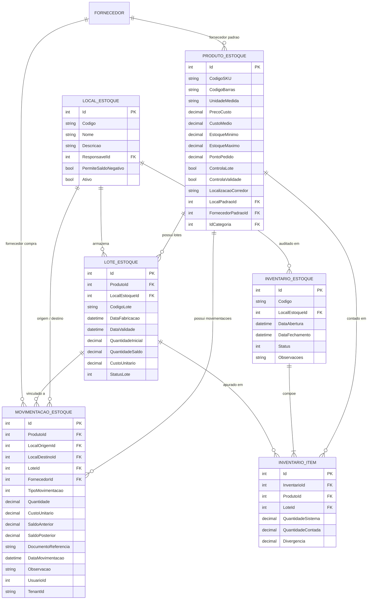

# Manual Técnico e Arquitetura Detalhada — JT_Estoque

Este documento contém o detalhamento técnico e a especificação de domínio do sistema **JT_Estoque**, servindo como referência de engenharia de software para desenvolvedores, arquitetos e mantenedores.

---

## 1. Modelo de Domínio e Banco de Dados

Todas as entidades herdam de `ClasseBase` (proveniente de `JT_Aplicacao.Classes`) e utilizam anotações declarativas para geração e sincronização automática de schema com o banco de dados SQL Server através do `DbSchemaMigrator`.

### 1.1 Diagrama Entidade-Relacionamento (ERD)



---

## 2. Detalhamento das Entidades

### 2.1 `ProdutoEstoque`
- **Tabela:** `Produtos`
- **Herança:** Estende `Produto` (de `JT_Classes.Produto`), aproveitando dados fiscais, descrição, preço de venda e status geral de ativação.
- **Campos Específicos de Estoque:**
  - `CodigoSKU` (`VARCHAR(60)`): Identificador interno logístico único por mercadoria.
  - `CodigoBarras` (`VARCHAR(60)`): Código EAN/GTIN para leitura por leitor de código de barras.
  - `UnidadeMedida` (`VARCHAR(10)`): Sigla da unidade de controle (ex: `UN`, `CX`, `KG`, `M`, `L`). Padrão: `"UN"`.
  - `LocalPadraoId` / `LocalPadrao`: Almoxarifado preferencial para alocação de estoque.
  - `FornecedorPadraoId` / `FornecedorPadrao`: Fornecedor habitual para requisições de compra.
  - `PrecoCusto` (`DECIMAL(18,4)`): Valor da última compra realizada.
  - `CustoMedio` (`DECIMAL(18,4)`): Custo Médio Ponderado Móvel (CMP) recalculado a cada aquisição.
  - `EstoqueMinimo`, `EstoqueMaximo`, `PontoPedido` (`DECIMAL(18,4)`): Parâmetros da curva de reposição de suprimentos.
  - `ControlaLote` (`BIT`): Sinaliza obrigatoriedade de informar lote nas movimentações.
  - `ControlaValidade` (`BIT`): Sinaliza rastreabilidade temporal e prioridade FEFO.
  - `LocalizacaoCorredor` (`VARCHAR(50)`): Endereçamento de armazém (ex: `A-02-P4`).

### 2.2 `LocalEstoque`
- **Tabela:** `LocaisEstoque`
- **Finalidade:** Representa um almoxarifado, galpão logístico, centro de distribuição (CD) ou filial.
- **Campos Principais:**
  - `Codigo` (`VARCHAR(30)`): Código amigável (ex: `ALM-CENTRAL`, `LOJA-01`).
  - `Nome` (`VARCHAR(120)`): Descrição oficial do local.
  - `ResponsavelId`: Referência a uma pessoa/usuário (`Pessoas`).
  - `PermiteSaldoNegativo` (`BIT`): Se `false`, o sistema bloqueia qualquer operação que resulte em saldo menor que zero dentro deste almoxarifado específico.
  - `Ativo` (`BIT`): Controla disponibilidade do almoxarifado para novas movimentações.

### 2.3 `LoteEstoque`
- **Tabela:** `EstoqueLotes`
- **Finalidade:** Segmentação de produtos perecíveis, fármacos, químicos ou controlados por lote de fabricação.
- **Status do Lote (`eStatusLote`):**
  - `1 = Disponivel`: Disponível para expedição normal.
  - `2 = Quarentena`: Bloqueado temporariamente aguardando aprovação de controle de qualidade.
  - `3 = Bloqueado`: Bloqueado por auditoria ou não-conformidade.
  - `4 = Vencido`: Data de validade superada.
  - `5 = Esgotado`: Saldo zerado.
- **Campos Chave:**
  - `DataFabricacao` e `DataValidade`: Controlam a fila de atendimento FEFO (*First Expired, First Out*).
  - `QuantidadeInicial` e `QuantidadeSaldo`: Controlam a evolução de consumo do lote.
  - `CustoUnitario`: Custo de aquisição específico do lote.

### 2.4 `MovimentacaoEstoque`
- **Tabela:** `EstoqueMovimentacoes`
- **Interface:** Implementa `IDataSegregada` para isolamento de dados por Tenant (`TenantId`).
- **Naturezas de Movimentação (`eTipoMovimentacaoEstoque`):**
  - **Entradas:**
    - `1 = EntradaCompra`: Aquisição via NF ou fornecedor.
    - `5 = TransferenciaEntrada`: Recebimento de transferência de outro almoxarifado.
    - `6 = AjusteInventarioPositivo`: Correção para maior após contagem física.
    - `9 = DevolucaoCliente`: Retorno de mercadoria faturada.
  - **Saídas:**
    - `2 = SaidaVenda`: Baixa por pedido/faturamento.
    - `3 = SaidaConsumoInterno`: Baixa para uso próprio ou requisição interna.
    - `4 = TransferenciaSaida`: Envio de mercadoria para outro local.
    - `7 = AjusteInventarioNegativo`: Correção para menor após contagem física.
    - `8 = PerdaOuAvaria`: Quebra, sinistro, dano ou avaria de produto.
    - `10 = DevolucaoFornecedor`: Retorno de compra defeituosa/incorreta.
- **Campos de Auditoria:**
  - `SaldoAnterior` e `SaldoPosterior`: Permite conferência instantânea sem necessidade de somatório em cascata.
  - `DocumentoReferencia`: Número da NF, pedido de venda ou código do inventário.
  - `UsuarioId`: Usuário que realizou o lançamento.

### 2.5 `InventarioEstoque` e `InventarioItem`
- **Tabelas:** `EstoqueInventarios` e `EstoqueInventarioItens`
- **Ciclo de Vida do Inventário:**
  ```mermaid
  stateDiagram-v2
      [*] --> Aberto: Abrir Sessão de Inventário
      Aberto --> EmContagem: Digitação das Contagens Físicas
      EmContagem --> Processado: Processar Inventário (Ajuste Kardex)
      Aberto --> Cancelado: Cancelar Sessão
      EmContagem --> Cancelado: Cancelar Sessão
      Processado --> [*]
      Cancelado --> [*]
  ```
- O cálculo da divergência é dado por:
  $$\text{Divergência} = \text{QuantidadeContada} - \text{QuantidadeSistema}$$
- No encerramento, se a divergência for:
  - **Positiva ($> 0$):** Gera automaticamente `AjusteInventarioPositivo`.
  - **Negativa ($< 0$):** Gera automaticamente `AjusteInventarioNegativo`.
  - **Nula ($= 0$):** Nenhuma movimentação é necessária.

### 2.6 View Dinâmica: `VwSaldoEstoquePorLocal`
Mapeada via atributo `[MapearComoView]` e executada no banco com a instrução:

```sql
CREATE OR ALTER VIEW VwSaldoEstoquePorLocal AS
SELECT 
    CAST(ROW_NUMBER() OVER(ORDER BY l.Id, p.Id) AS INT) AS Id,
    l.Id AS LocalId,
    l.Nome AS NomeLocal,
    p.Id AS ProdutoId,
    p.Nome AS NomeProduto,
    p.CodigoSKU,
    p.UnidadeMedida,
    ISNULL(SUM(CASE 
        WHEN m.LocalDestinoId = l.Id THEN m.Quantidade
        WHEN m.LocalOrigemId = l.Id AND m.LocalDestinoId IS NOT NULL THEN -m.Quantidade
        WHEN m.LocalOrigemId = l.Id AND m.TipoMovimentacao IN (1, 5, 6, 9) THEN m.Quantidade
        WHEN m.LocalOrigemId = l.Id AND m.TipoMovimentacao IN (2, 3, 4, 7, 8, 10) THEN -m.Quantidade
        ELSE 0 END), 0) AS SaldoLocal,
    ISNULL(p.CustoMedio, 0) AS CustoMedio,
    ISNULL(p.CustoMedio, 0) * ISNULL(SUM(CASE 
        WHEN m.LocalDestinoId = l.Id THEN m.Quantidade
        WHEN m.LocalOrigemId = l.Id AND m.LocalDestinoId IS NOT NULL THEN -m.Quantidade
        WHEN m.LocalOrigemId = l.Id AND m.TipoMovimentacao IN (1, 5, 6, 9) THEN m.Quantidade
        WHEN m.LocalOrigemId = l.Id AND m.TipoMovimentacao IN (2, 3, 4, 7, 8, 10) THEN -m.Quantidade
        ELSE 0 END), 0) AS ValorTotalEstoque
FROM LocaisEstoque l
CROSS JOIN Produtos p
LEFT JOIN EstoqueMovimentacoes m ON (m.LocalOrigemId = l.Id OR m.LocalDestinoId = l.Id) AND m.ProdutoId = p.Id
GROUP BY l.Id, l.Nome, p.Id, p.Nome, p.CodigoSKU, p.UnidadeMedida, p.CustoMedio;
```

---

## 3. Serviços e Lógicas de Negócio

### 3.1 `MovimentacaoEstoqueService`
Classe central para lançamento da ficha Kardex:

1. **Validação de Saldo Negativo:**
   - Consulta a configuração ativa do tenant (`IMGestaoConfiguracaoService.GetAtivaAsync()`).
   - Se `PermitirVendaEstoqueNegativo == false` e o saldo resultante for negativo, interrompe a transação lançando `InvalidOperationException`.
2. **Cálculo de Custo Médio Ponderado Móvel (CMP):**
   - Aplicado exclusivamente em entradas por compra (`EntradaCompra`) com custo unitário informado:
   $$\text{CMP}_{\text{novo}} = \frac{(\text{SaldoAtual} \times \text{CMP}_{\text{atual}}) + (\text{QtdComprada} \times \text{CustoUnitario})}{\text{SaldoAtual} + \text{QtdComprada}}$$
   - Atualiza `PrecoCusto` com o último custo pago.
3. **Controle de Saldo por Lote:**
   - Se a movimentação possuir `LoteId`, abate ou incrementa `lote.QuantidadeSaldo`.
   - Caso `QuantidadeSaldo <= 0`, o status do lote é automaticamente alterado para `eStatusLote.Esgotado`.
4. **Atualização Atômica da Entidade:**
   - Persiste a movimentação com carimbo de `SaldoAnterior`, `SaldoPosterior` e `DataMovimentacao`.
   - Atualiza o campo `QuantidadeEstoque` consolidado na tabela `Produtos`.

---

## 4. Ferramentas de Inteligência Artificial (Semantic Kernel)

O sistema expõe ferramentas nativas herdando de `IAToolBase` para os agentes de IA operantes na plataforma:

### 4.1 `ConsultarKardexProdutoTool`
- **Nome da Tool:** `consultar_kardex_produto`
- **Propósito:** Retorna a posição cadastral de um produto junto com o extrato das últimas 10 movimentações.
- **Entrada:** `sku` (string) ou `produtoId` (int).
- **Formato da Resposta:**
  ```json
  {
    "Produto": {
      "Id": 10,
      "CodigoSKU": "PAR-INOX-M6",
      "Nome": "Parafuso Inox Sextavado M6",
      "SaldoAtual": 150.0,
      "CustoMedio": 0.45,
      "UnidadeMedida": "UN"
    },
    "TotalMovimentacoes": 42,
    "UltimasMovimentacoes": [
      {
        "Id": 128,
        "Data": "19/10/2026 14:30",
        "Tipo": "EntradaCompra",
        "Quantidade": 100.0,
        "CustoUnitario": 0.42,
        "SaldoAnterior": 50.0,
        "SaldoPosterior": 150.0,
        "DocumentoReferencia": "NF-8921",
        "Observacao": "Lote recebido com laudo"
      }
    ]
  }
  ```

### 4.2 `ConsultarRupturaEstoqueTool`
- **Nome da Tool:** `consultar_ruptura_estoque`
- **Propósito:** Detecta produtos ativos que estão com `QuantidadeEstoque <= EstoqueMinimo`.
- **Formato da Resposta:**
  ```json
  {
    "TotalItensEmRuptura": 2,
    "Itens": [
      {
        "Id": 5,
        "CodigoSKU": "OLEO-MOT-15W40",
        "Nome": "Óleo de Motor 15W40 1L",
        "SaldoAtual": 3.0,
        "EstoqueMinimo": 20.0,
        "PontoPedido": 35.0,
        "Deficit": 17.0,
        "CustoMedio": 28.50
      }
    ]
  }
  ```

---

## 5. Guia para Extensão do Sistema

### 5.1 Adicionar uma Nova Regra de Negócio
Para criar uma validação que intercepte automaticamente qualquer gravação de entidade:
1. Crie uma classe no namespace `JT_RegrasNegocios.Estoque` em `src/JT_Estoque.Core/Rules/`.
2. Herde de `RegraNegocioValidacao`.
3. Decore a classe com os atributos:
   - `[RegraPara(typeof(SuaEntidade))]`
   - `[TipoRegra("Restricao")]`
   - `[MomentoExecucao("Antes")]`
   - `[EventoAcao("Salvar")]`
4. Sobrescreva o método `bool Validar(object entidade)`.
5. O engine do `JT_RegrasNegocios` fará o auto-discovery no startup da aplicação sem necessidade de registro manual.

### 5.2 Adicionar uma Nova Tool de IA
1. Crie uma classe em `src/JT_Estoque.Core/IATools/` herdando de `IAToolBase`.
2. Implemente os métodos `ExecutarAsync` e anote a função executora com `[KernelFunction("nome_da_tool")]` e `[Description("Descrição clara da funcionalidade")]`.
3. Registre no contêiner de DI em `Program.cs` com:
   ```csharp
   builder.Services.AddScoped<IAToolBase, SuaNovaTool>();
   ```
